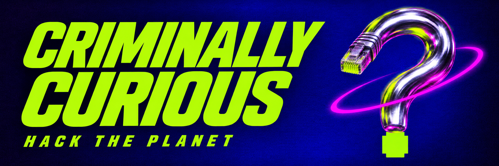

# Curiosity, code, and collective mischief.

Bring your questions, your half-built ideas, and that thing you can't stop thinking about.

This is a home for bots, tools, art, and weird little machines by **[villageAlchemist](https://github.com/villagealchemist) & friends**. We learn how things work by making things work, taking them apart, and leaving useful notes for whoever comes next.

## WHAT'S IN THE MACHINE?

| Project             | The short version                                                                                   | Find your way in                                                               |
| ------------------- | --------------------------------------------------------------------------------------------------- | ------------------------------------------------------------------------------ |
| **Butch**           | Our Discord bot and a hands-on workbench for learning bot architecture.                             | [Project notes](./projects.md#butch). Source access is by invitation.          |
| **IconForge**       | A macOS icon tool with a very particular job and room for a lot of personality.                     | [Explore the existing project](https://github.com/villagealchemist/iconforge). |
| **Series of Tubes** | Architecture experiments for connecting tools and services with explicit contracts and permissions. | [Project notes](./projects.md#series-of-tubes). Work in progress.              |

Each project keeps its own name, documentation, and actual completion state. This is where the threads meet.

## FIRST TIME HERE?

Start with one thing:

- Ask the question in the relevant project's issues.
- Show what you tried, what happened, and what you expected.
- Improve an explanation, sketch an idea, or propose a small change.
- Tell us where the instructions lost you. That feedback is part of building the thing.

Working from a phone? You can write, review, discuss, and propose edits. A collaborator can run checks on your exact proposed commit while you work through the results together.

Beginners belong here. So do people who have been doing this forever and still have questions.

[Bring your curiosity](../CONTRIBUTING.md) · [Ask a question](https://github.com/criminally-curious/.github/issues/new/choose) · [Find villageAlchemist](https://villagealchemist.com/)

---

**Hack the planet. Start with one good question.**
